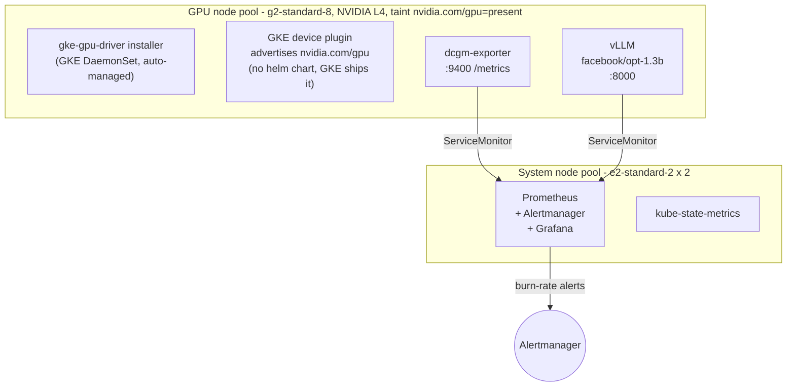

# GPU Observability on GKE

Reliability and cost observability for GPU workloads on Google Kubernetes
Engine. A real, applyable cluster that provisions an L4 node pool on GKE's
managed GPU runtime, runs **DCGM exporter** against the GKE-installed driver,
and surfaces the gap that drives GPU cost: **allocated GPU vs working GPU**.

Built to be stood up, demonstrated, and destroyed the same day. Single
`g2-standard-8` (one NVIDIA L4, 24 GB), so a full apply/demo/destroy cycle
costs a few dollars.

> Companion to [gpu-observability-eks](https://github.com/bibigon14/gpu-observability-eks).
> Same observability story (DCGM metrics, vLLM, kube-prometheus-stack, SLO
> burn-rate alerts, cost dashboards) on a different cloud and a newer GPU
> generation. Side-by-side the two repos show which parts of the design are
> cloud-portable and which pieces (driver install, node pool shape, device
> plugin) are not.

## Why this exists

GPUs are the most expensive compute in a cluster, and the default scheduler
view of them is binary and misleading:

- A pod requests `nvidia.com/gpu: 1` and holds a **whole** card. There is no
  "millicore" equivalent - allocation is all-or-nothing unless you configure
  time-slicing or MIG.
- `nvidia-smi` / `DCGM_FI_DEV_GPU_UTIL` reports "utilization" that only means
  _a kernel was running_. A tiny kernel on one SM shows 100%. A card can look
  saturated and be almost idle.

So the expensive failure mode is a GPU that is **allocated but idle**: memory
reserved, a workload resident, engines doing nothing. On a fleet of A100s or
H100s that gap is burned money. This project makes it visible and alerts on
it.

## Architecture

GKE in `us-west1`, zonal (one control plane, cheap for a demo), two node
pools:



Two layers of alerting riding on the DCGM and vLLM metrics (will ship with
v0.2 and v0.3 - see roadmap below): one reliability layer (`VLLMHighTTFT`,
`VLLMQueueBackup`, `GPUAllocatedButIdle`), one SLO layer (multi-window
multi-burn-rate on `p99 TTFT < 1s` straight from the Google SRE Workbook
chapter 5).

## What's different from the EKS mirror

The observability story is identical. The host story is not:

| Aspect             | EKS (companion repo)                                 | GKE (this repo)                                                                 |
|--------------------|------------------------------------------------------|---------------------------------------------------------------------------------|
| GPU driver         | Pre-baked in the AL2023 accelerated AMI              | Installed by GKE's `gke-gpu-driver` DaemonSet on demand                         |
| Device plugin      | We ship `nvidia-device-plugin` Helm chart            | GKE ships it automatically with the driver                                      |
| Node taint         | Declared in Terraform (`nvidia.com/gpu=true`)        | Added by GKE automatically (`nvidia.com/gpu=present`)                           |
| DCGM exporter      | Helm chart, same version                             | Helm chart, same version                                                        |
| vLLM manifests     | Same `facebook/opt-1.3b` image, same ServiceMonitor  | Same, modulo the toleration value (`true` -> `present`)                         |
| Cluster networking | AWS VPC CNI                                          | GKE Dataplane V2 (eBPF, Cilium-based)                                           |

The Terraform code for the GKE side is **shorter** than the EKS side because
of these managed pieces. That is itself a portfolio point: picking the cloud
on the strength of its managed GPU story is a real trade-off and worth being
able to speak to.

## Deploy

See [`bootstrap.md`](bootstrap.md) for the one-time GCS state bucket and GPU
quota setup. Then:

```bash
cd terraform
cp terraform.tfvars.example terraform.tfvars
# edit terraform.tfvars: project_id, grafana_admin_password

terraform init
terraform apply
```

Roughly:

1. VPC + subnet (secondary ranges for Pods and Services)
2. GKE cluster (zonal, release channel REGULAR, Dataplane V2)
3. System node pool (e2-standard-2 x 2) for kube-prometheus-stack
4. GPU node pool (g2-standard-8, 1x L4, Spot by default, 150 GB pd-balanced)
5. kube-prometheus-stack helm release
6. DCGM exporter helm release (depends_on the GPU pool existing)

End-to-end ~12 minutes.

When done:

```bash
terraform destroy
```

The GPU pool is Spot by default (~60-80% cheaper); flip
`gpu_spot = false` if a specific demo capture needs guaranteed-not-preempted.

## Status

**v0.1** (scaffold in flight): Terraform brings up the cluster, both node
pools, kube-prometheus-stack, and DCGM exporter. GPU quota already approved
in us-west1.

**Up next** (mirroring the EKS repo's shipped v0.2 - v0.5):

- vLLM Deployment + Service + ServiceMonitor (`manifests/vllm/`); capture the
  allocated-but-idle and under-load screenshots on L4 for the README.
- Reliability alerts: `GPUAllocatedButIdle`, `VLLMHighTTFT`,
  `VLLMQueueBackup`, `VLLMKVCacheSaturated`, `VLLMSwappingUnderLoad`.
- SLO + cost dashboards: multi-window multi-burn-rate on `p99 TTFT < 1s`,
  cost records against the L4 on-demand hourly rate, `$/million tokens`
  headline figure.
- KEDA ScaledObject + a small chaos CronJob mirroring the EKS v0.5 demo:
  kill a vLLM pod every 5 minutes under load and watch the burn-rate alerts
  trip.

## License

[Apache 2.0](LICENSE).
